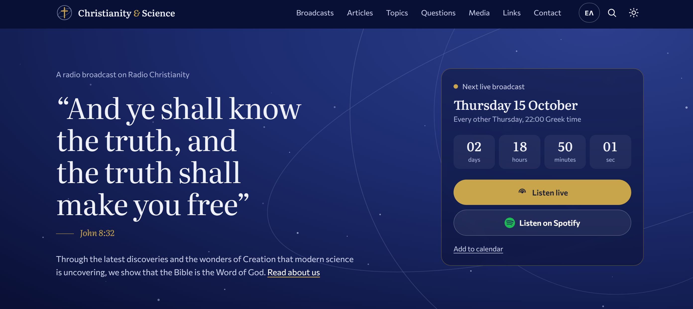
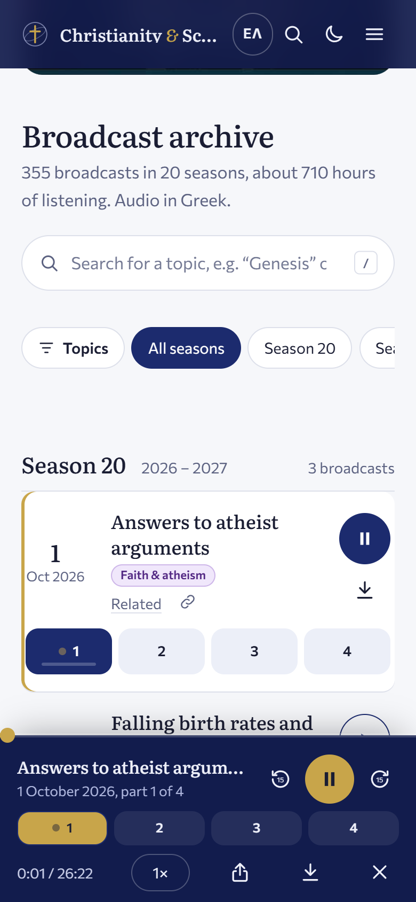

# Christianity & Science — christianity-science.gr

The website of **«Χριστιανισμός & Επιστήμη»** (*Christianity & Science*), a Greek radio broadcast on
Radio Christianity since 2008: every broadcast to listen to (355 so far, about 710 hours), the team's
newspaper column, topic studies, questions from listeners and more, in Greek and English.





## What the site does

- **Listening.** One player that stays at the bottom while you browse the whole site; it carries on
  to the next half-hour by itself, remembers where you stopped («Συνέχεια», *Resume*) and plays at 0.75×–2×.
- **Phone and computer.** Lock-screen and car controls with the show's cover and a progress bar;
  a share button on phones; a small always-on-top mini player on computers (Chrome and Edge).
- **Finding broadcasts.** Forgiving search (no accents needed, typos, Greeklish), 21 coloured
  topics, seasons, and «Σχετικά» (*Related*): related broadcasts, articles, topics and questions.
- **Site-wide search** from the top bar of every page (`/` or `Ctrl+K`).
- **Next live broadcast** with a countdown and a calendar file (.ics).
- **Spotify** and other podcast apps, through the podcast feed `podcast.xml`.
- **English.** Every page also in English (`en/`), including the newspaper column.
- **Light and dark** theme; fits any screen; every broadcast has its own link (`index.html#e-2026_09_17`).

<br clear="right">

## Folders

```
index.html            Home page: next live broadcast, latest broadcast, column, video, broadcast archive
about, articles, material, faq, media, links, contact, column .html     The other main pages
articles/  categories/  material/  column/     Articles, topic categories, topic studies, newspaper column
en/                   The English site (made by tools/build_en.py, do not edit by hand)
css/site.css          All the styling (fonts/: the site's own copies of its two fonts)
js/broadcasts.js      THE DATA: every broadcast, its topics, and the site settings (SITE_CONFIG)
js/broadcasts-en.js   English titles of the broadcasts and topics
js/app.js             Home page: archive, search, topics, player, countdown, keep-playing-while-browsing
js/page.js            Other pages: theme, menu, list filters
js/search.js  js/sitesearch.js  js/search-index.js   The search (shared matching, the top-bar panel, its index)
js/related.js  data/  The «Σχετικά» (Related) links and other generated data
podcast.xml           The podcast feed for Spotify (made by tools/podcast.py)
pictures/             Pictures, the podcast cover and its smaller copies
files/  mp3/          PDFs and audio: kept on the web host, not in git (about 20 GB)
translation/          English translations (en.json, the column in translation/column/, STYLE.md)
tools/                The build and publishing tools (below)        tests/   Automatic tests (below)
admin/                The upload page (PHP), served at a secret address on the server
docs/                 SETUP.md (moving to webleaders, the upload page), ODIGOS-DIAXEIRISTI.md (admin guide, Greek)
```

## Adding a new broadcast

**The usual way: the upload page.** The admin signs in, gives the date and title, drags in the mp3s and
presses «Αποστολή». No code is touched. `tools/inbox.py` (GitHub Action `inbox.yml`) then:
- checks everything, and never adds the same broadcast twice;
- names and joins the mp3s and puts them on the server;
- adds the broadcast to `js/broadcasts.js`, rebuilds, commits and deploys.

Spotify follows by itself. The admin's guide (Greek) is [docs/ODIGOS-DIAXEIRISTI.md](docs/ODIGOS-DIAXEIRISTI.md);
the setup is in [docs/SETUP.md](docs/SETUP.md).

**By hand** (if everything else is unavailable):
1. In `js/broadcasts.js`, add one line at the top of the current season, with 1–3 topics (most relevant
   first; the topic names are listed in the same file):
   ```js
   ep("2026-10-15", "Title of the broadcast", "Slug_of_the_file", { cs: true, tags: "creation bible" }),
   ```
   `cs: true` if the mp3 names start with `CS_`; `parts: 3` if it has 3 half-hours instead of 4.
2. Add its English title in `js/broadcasts-en.js`.
3. Put its mp3s in `mp3/broadcasts/Season_NN/YYYY_MM_DD/` and run `python tools/join_broadcasts.py`
   (makes the whole-broadcast mp3).
4. Run `python tools/build_all.py`, upload the new mp3s to the web host, then commit and push. The push
   deploys the pages.

## Building

After any change to pages, `css/` or `js/`, run `python tools/build_all.py`. In order, it runs:

| Tool | What it does |
|---|---|
| `related.py` | «Σχετικά» (*Related*) links between broadcasts, column articles, topics and questions |
| `site_search.py` | The site-wide search index and the search button on every page |
| `build_en.py` | The English pages from the Greek ones and `translation/` |
| `seo.py` | Addresses for search engines and sharing cards, `sitemap.xml`, `robots.txt` |
| `podcast.py` | `podcast.xml`, the podcast feed (measures new mp3s with ffprobe) |
| `stamp.py` | Version stamps (`?v=…`) so browsers load the new CSS and JS |

Publishing tools (Python standard library only, so they keep working without updates):
- `inbox.py` publishes what the upload page hands in;
- `deploy.py` puts the changed files on the server by FTP;
- `sync_mp3.py` copies new mp3s from the server to this computer, as a second copy;
- `setup_server.py` sets everything up in one go (FTP account, private folder, the page's settings, GitHub
  secrets, a checked trial), then `--go-live`;
- `admin_user.py` makes the upload page's settings and users by hand;
- `serverfs.py` is the FTP connection they share.

Other tools: `update_column.py` (fetches new newspaper column articles), `join_broadcasts.py`
(whole-broadcast mp3s, needs ffmpeg), `podcast_cover.js` (the podcast cover from
`tools/podcast-cover.html`). Needs Python 3 and Node.js.

## How the site goes live

- **Pages:** on the webleaders server (www.christianity-science.gr). Every push to `main` deploys there
  (`deploy.yml` → `tools/deploy.py`: only changed files; `mp3/`, `files/` and the old site's other pages
  are never touched). Before the switch, the site was also on [Render](https://render.com)
  (https://christianity-science.onrender.com/), which forwards `/mp3/…` to the server.
- **Audio:** the mp3s and PDFs live only on the server (and as a second copy in `mp3/` on the editor's
  computer: `tools/sync_mp3.py`).
- **Upload page and inbox:** `admin/` at a secret address. It is invisible without a device key and
  needs a password and an authenticator code. See [docs/SETUP.md](docs/SETUP.md).
- **Newspaper column:** every day a GitHub Action (`.github/workflows/update-column.yml`) adds new
  articles, rebuilds, commits and deploys.
- **Checks:** every Monday `monitor.yml` checks the live site and every mp3 in the podcast feed. A failed
  workflow emails the repository's owner.
- **Spotify:** the show reads `podcast.xml`
  (https://open.spotify.com/show/6eyFkp4HBWCa4byp7F0CI1). The feed is set in `SITE_CONFIG`:
  - `podcastSite`: where the site is;
  - `podcastAudio`: where the mp3s are;
  - `podcastParts`: for now each half-hour is an episode; `false` makes one episode per whole broadcast;
  - `podcastEmail`: the owner address Spotify checks.
- **The domain:** on switch day, follow [docs/SETUP.md](docs/SETUP.md) § 4.

## Tests

```
node --test tests/static.test.js          # data, pages, links, feed, translations (no browser)
node tests/server.js                       # serves the site at http://127.0.0.1:8081/ (also for previewing)
node --test tests/browser.test.js          # in Chrome or Edge: player, search, topics, phone layout…
node tests/live-check.js                   # after going live: every page and file loads on the real site
python -m unittest discover -s tests -p "test_*.py"   # publishing: inbox, deploy, FTP, setup, upload page
node --test tests/admin_browser.test.js               # the upload page in Chrome (needs php, ffmpeg, puppeteer-core)
```
The browser tests need `npm install --prefix tests puppeteer-core` once. Details: [tests/README.md](tests/README.md).
